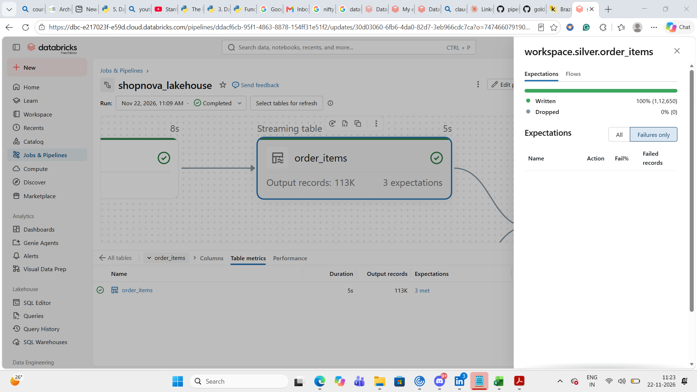

# lakehouse-reference-architecture
Design-first reference for a governed, cost-aware Lakehouse on Azure Databricks. Covers Medallion layers, Delta Live Tables, Unity Catalog, ADRs and CI/CD using the public Olist dataset.

## Results

The first slice runs end to end on Databricks using the public Olist dataset.

| Layer | Table | Type | Records |
|-------|-------|------|---------|
| Bronze | orders | Streaming table | ~99K |
| Bronze | order_items | Streaming table | ~113K |
| Silver | orders | Streaming table, 3 expectations | ~99K |
| Silver | order_items | Streaming table, 3 expectations | ~113K |
| Gold | daily_sales | Materialized view | 614 |

**Observations**
- Silver expectations: [fill in rows passed/dropped from the data quality view]
- The Gold materialized view currently shows a full recompute on each refresh.
  Incremental refresh is a later optimization (see the cost study).