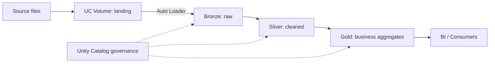
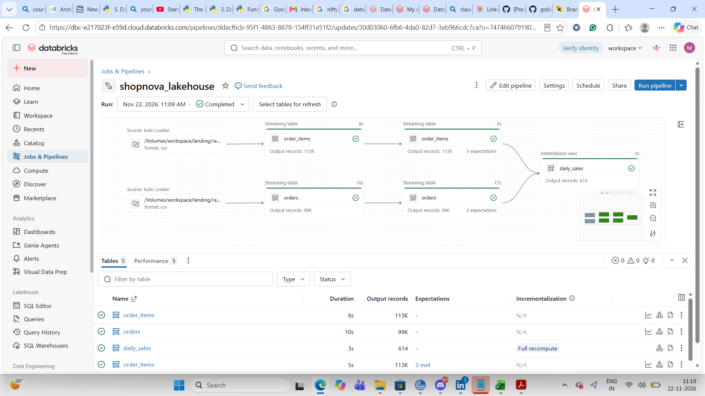

# Lakehouse Reference Architecture

Design-first reference for a governed, cost-aware Lakehouse on Azure Databricks.
Covers Medallion layers, Lakeflow Spark Declarative Pipelines (formerly Delta Live Tables),
Unity Catalog, ADRs and CI/CD, using the public Olist e-commerce dataset.

The goal is to show the decisions behind the platform, not just the code.

## Problem
A fictional online retailer, "ShopNova", has data spread across several source
systems and needs one trusted, governed view of sales for multiple business teams.
See [requirements](docs/01-requirements-and-nfrs.md).

## Architecture

More diagrams: [diagrams/architecture.md](diagrams/architecture.md)

## Key decisions
| # | Decision | Doc |
|---|----------|-----|
| 001 | Medallion layers (Bronze, Silver, Gold) | [ADR-001](docs/adr/001-medallion-layers.md) |
| 002 | Declarative Pipelines for transformations, Lakeflow Jobs for orchestration | [ADR-002](docs/adr/002-sdp-vs-jobs.md) |
| 003 | Streaming tables for Bronze/Silver, materialized views for Gold | [ADR-003](docs/adr/003-streaming-tables-vs-materialized-views.md) |

## Tech stack
Azure Databricks, Lakeflow Spark Declarative Pipelines, Unity Catalog, Delta Lake,
PySpark, Auto Loader, GitHub Actions and Terraform / Asset Bundles (planned).

## Results

The first slice runs end to end on Databricks using the public Olist dataset.

| Layer | Table | Type | Records |
|-------|-------|------|---------|
| Bronze | orders | Streaming table | ~99K |
| Bronze | order_items | Streaming table | ~113K |
| Silver | orders | Streaming table, 3 expectations | ~99K |
| Silver | order_items | Streaming table, 3 expectations | ~113K |
| Gold | daily_sales | Materialized view | 614 |

**Observations**
- Silver expectations: all rows passed on this dataset (orders: 99,441 in Bronze and
  99,441 in Silver; order items: 112,650 in both). The expectations and
  deduplication are in place for dirtier real-world sources.
- The Gold materialized view currently shows a full recompute on each refresh.
  See ADR-003 for the follow-up.

## Repo layout
- `docs/` requirements, architecture notes, ADRs
- `diagrams/` Mermaid diagram sources
- `src/ingestion/` Bronze pipeline code
- `src/transformations/` Silver and Gold pipeline code
- `tests/` unit tests (planned)
- `infra/` deployment code (planned)

## How to run
1. Download the Olist dataset from Kaggle (not included in this repo).
2. In Databricks, create the schemas `landing`, `bronze`, `silver`, `gold` and the
   volume `landing.raw`.
3. Upload `olist_orders_dataset.csv` to `/Volumes/<catalog>/landing/raw/orders/`
   and `olist_order_items_dataset.csv` to `/Volumes/<catalog>/landing/raw/order_items/`.
4. Create an ETL pipeline with the files in `src/` and set the default catalog.
5. Run the pipeline.

## Status
- [x] Repo structure
- [x] Requirements and NFRs
- [x] Architecture diagram and ADRs 001-003
- [x] Bronze/Silver/Gold slice
- [ ] Unity Catalog governance (grants, masking, lineage)
- [ ] CI/CD with Asset Bundles
- [ ] Cost and migration docs

## Data
Olist Brazilian E-Commerce Public Dataset from Kaggle. Check its license before
reuse. No employer data is used in this repo.